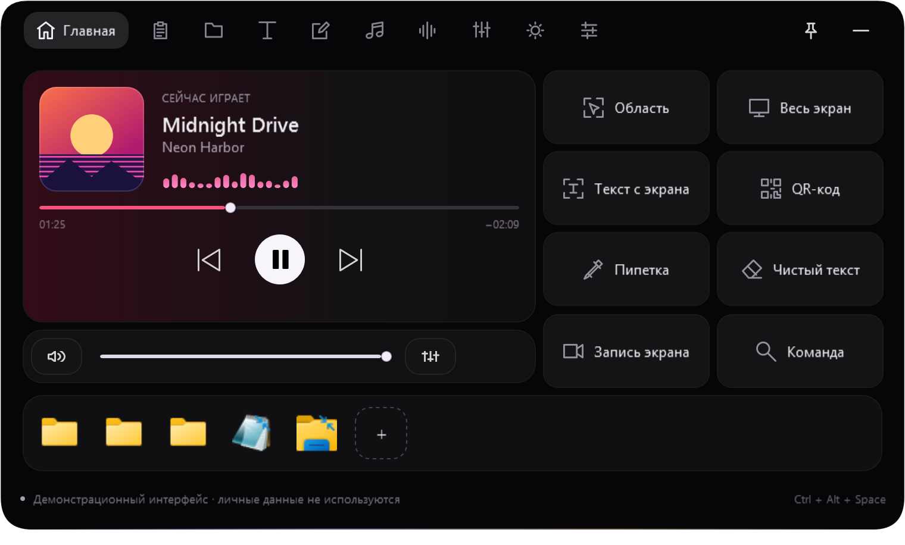
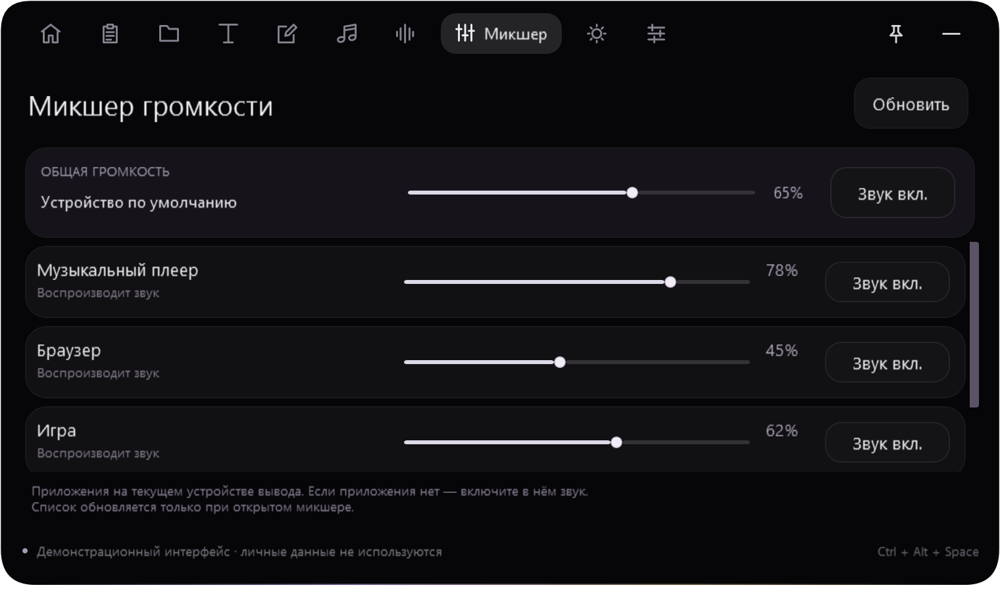
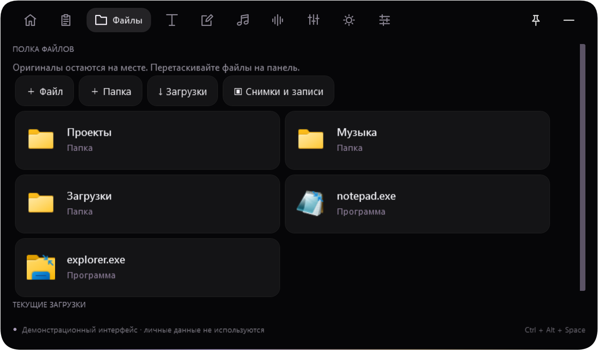
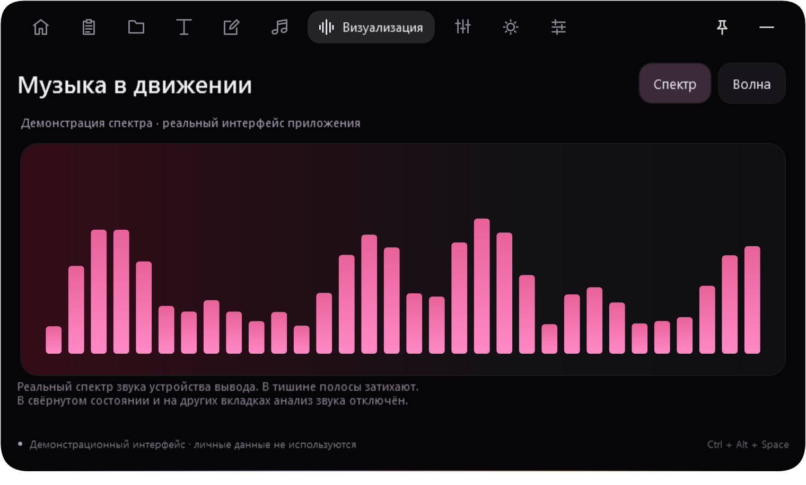
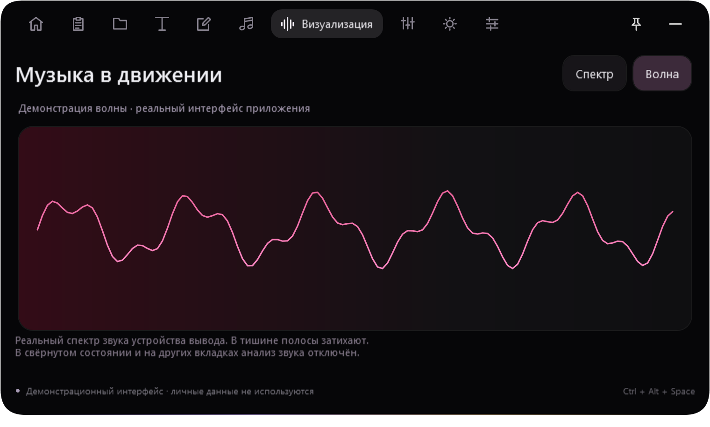

# Island Panel

**Компактный центр управления Windows — музыка, звук, файлы и полезные инструменты в одном острове.**

Самостоятельное приложение на C# / WPF / .NET 10. Без ИИ, подписки и обязательной учётной записи. Основное окно скрыто из Alt+Tab и панели задач; управление доступно через остров, трей и горячие клавиши.



## Скриншоты

Настоящий интерфейс приложения. Названия треков, папки, уровни микшера и графики на этих кадрах — демонстрационные данные, без личной информации.

| Микшер приложений | Папки и программы |
| --- | --- |
|  |  |

| Спектр звука | Волновая визуализация |
| --- | --- |
|  |  |

Компактный остров:


## Скачать и запустить

1. Откройте [последний релиз](../../releases/latest).
2. Скачайте `IslandPanel-1.3.2-win-x64.zip` и полностью распакуйте архив в отдельную папку.
3. Запустите **`Island Panel.exe`**. Сохраняйте папки `app` и `tools` рядом с ним.

**Система:** Windows 10 2004 или новее / Windows 11, x64. Среда .NET включена в готовый архив. Установка и права администратора не требуются. Исполняемые файлы не подписаны сертификатом издателя.

По умолчанию панель запускается свёрнутой, не забирает фокус, не раскрывается при случайном наведении и не закрепляется поверх других приложений. Если остров перекрыт окном, откройте его через трей или **Ctrl+Alt+Space**. Автозапуск выключен и включается в настройках.

## Возможности

| Раздел | Что умеет |
| --- | --- |
| Музыка | Название, исполнитель, обложка, пауза, переключение треков и перемотка через медиасессии Windows. Цвет плеера подстраивается под обложку. |
| Визуализация | Настоящий FFT-спектр и волна звука устройства вывода. Мини-спектр в плеере и отдельный большой вид. |
| Микшер | Общая громкость, громкость отдельных приложений и отключение звука через Windows Core Audio. |
| Файлы и папки | Полка с родными значками Windows, добавление перетаскиванием, изменение порядка, открытие и копирование пути. Оригиналы остаются на месте. |
| Буфер обмена | Локальная история текста и изображений, поиск и закрепление. Запись в историю можно отключить. |
| Текст | Смена раскладки RU/EN, регистр, транслитерация, очистка пробелов, JSON, Base64 и URL-кодирование. |
| Экран | Снимок области или монитора, локальный OCR Windows, пипетка, QR-коды и запись экрана в MP4 без звука. |
| Заметки и время | Несколько заметок, таймер фокуса и напоминания по простым правилам. |
| Быстрая команда | Арифметика, единицы измерения, справочные курсы валют и поиск программ. |
| Погода | Погода по выбранному городу через Open-Meteo. |

Поддержка музыкальных команд зависит от плеера. Визуализация анализирует **суммарный звук устройства вывода по умолчанию**, включая другие приложения. Она не использует микрофон и не сохраняет звук. Тексты песен и перехват системных уведомлений не реализованы.

## Управление

| Действие | Клавиши или элемент |
| --- | --- |
| Открыть / свернуть | `Ctrl+Alt+Space` |
| Быстрая команда | `Ctrl+Alt+Q` |
| Свернуть открытую панель | `Esc` или кнопка «−» |
| Открыть компактный остров | Нажатие мышью |
| Удерживать панель раскрытой | Кнопка закрепления; режим поверх всех окон включается отдельно |
| Выйти | Меню значка в трее → «Выход» |

## Плавность и нагрузка

Переходы конечные: после завершения контур не продолжает постоянно отрисовываться. При сворачивании и скрытии визуализатор освобождает захват звука и останавливает свои кадровые таймеры. На других разделах анализ также выключается; в плеере он работает при воспроизведении.

Визуализация работает до 30 кадров/с, в экономичном режиме — до 15. В тишине обновляется реже. Настройка «Экономия ресурсов» также уменьшает частоту фоновых проверок. Фактическая нагрузка зависит от оборудования, проигрывателя, драйверов и записи экрана.

## Данные и сеть

Данные создаются локально рядом с программой:

- `data/state.json` — настройки, заметки, полка, напоминания и история буфера;
- `data/clipboard` — изображения буфера;
- `captures` — снимки и записи.

Личные данные не включены в репозиторий и архив релиза. ИИ-сервисов и телеметрии в приложении нет. Погода использует Open-Meteo; запрос валютной пары — Frankfurter. Поиск открывается в браузере по действию пользователя. Буфер, заметки, изображения и анализируемый звук на эти сервисы не отправляются.

## Сборка из исходников

Нужны Windows x64, **.NET SDK 10** и доступ к NuGet:

```powershell
powershell -ExecutionPolicy Bypass -File .\build.ps1
```

Запуск — `Island Panel.exe` в корне проекта. Для записи экрана положите `ffmpeg.exe` в `tools` (официальные сборки: [gyan.dev](https://www.gyan.dev/ffmpeg/builds/)). Остальные функции работают без FFmpeg. Бинарные зависимости и выходные файлы сборки не хранятся в Git.

Проверки:

```powershell
dotnet run --project tests\IslandPanel.Tests.csproj -c Release
dotnet run --project tests\IslandPanel.Tests.csproj -c Release -- --ui
```

Для сквозных аудиопроверок нужны доступное устройство вывода Windows и пользовательская сессия. UI-проверки открывают тестовую панель. В версии 1.3.2 на локальной Windows прошла 81 проверка, включая аудио, шаблон подсказок, фокус при запуске и положение окна во время анимации.

Создание чистого переносимого архива после сборки:

```powershell
powershell -ExecutionPolicy Bypass -File .\package.ps1
```

Подробная инструкция — [README.txt](README.txt). История изменений — [CHANGELOG.md](CHANGELOG.md). Сторонние компоненты и лицензии — [THIRD-PARTY.txt](THIRD-PARTY.txt).

Приложение написано самостоятельно по визуальному примеру. Оно не связано с разработчиками Island и не является официальной версией их продукта.
